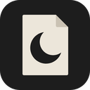
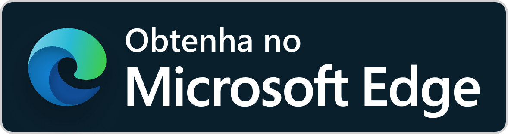
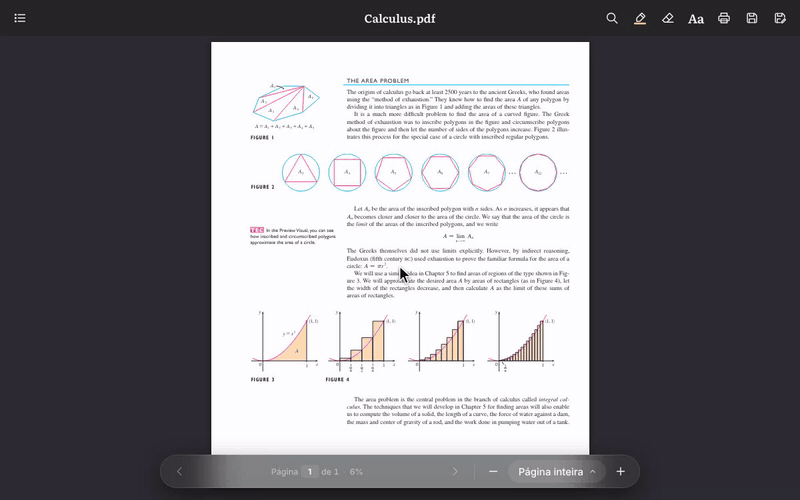
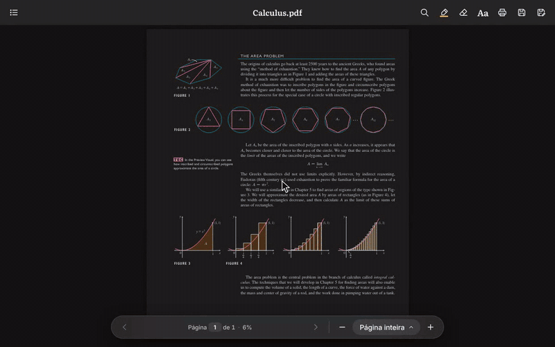
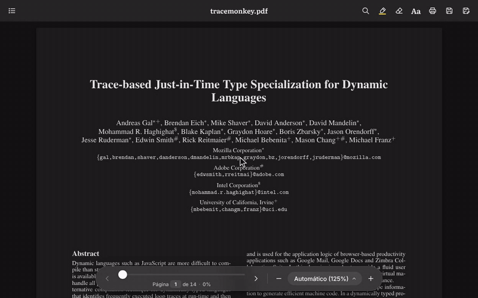

<p align="center">
  
</p>

<h1 align="center">Sereno</h1>

<p align="center">
  Leia qualquer PDF no modo escuro no Microsoft Edge e no Firefox (computador e Android), com as imagens nas cores reais.
</p>

<p align="center">
  <a href="https://microsoftedge.microsoft.com/addons/detail/limkplgjplglhfbcnehmmnjnfboidjkf">
    
  </a>
</p>

## Modo escuro em um clique

Texto e fundo ficam escuros; fotos e figuras mantêm as cores originais.



## Temas e filtro de luz azul

Escuro, Preto, Leitura, Sépia, Cinza e Personalizado, com filtro de luz azul de 0 a 100%.



## Pesquisa e marca-texto

Pesquisa no documento inteiro (sem diferenciar acentos) e marcações que saem no PDF salvo e na impressão.



## Também

- Abre PDFs no leitor escuro na mesma guia.
- Salva e imprime com o tema; o PDF salvo continua com texto selecionável.
- Sumário, zoom e atalhos de teclado.
- Interface em português, inglês, espanhol, francês, italiano e alemão.
- Nenhum dado é coletado: tudo acontece no seu computador.

## Instalar pelo código

1. Abra `edge://extensions` e ative o **Modo do desenvolvedor**.
2. Clique em **Carregar sem pacote** e escolha esta pasta.

Requer Edge 128 ou Firefox 128 (computador ou Android) ou mais recente.

## Gerar os pacotes das lojas

```bash
node tools/build.mjs
```

Cria `dist/sereno-edge-<versão>.zip` e `dist/sereno-firefox-<versão>.zip` (o mesmo pacote serve para o Firefox do computador e do Android). O pacote do Firefox usa o manifesto de `platforms/firefox/`.

## Licença

© 2026 AndreyCoosta. Todos os direitos reservados. Veja [LICENSE](LICENSE).
Bibliotecas e fontes de terceiros seguem as próprias licenças (pdf.js, pdf-lib, Literata e Inter).
